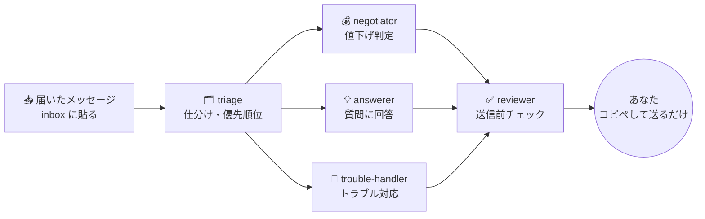

<div align="center">

# 💬 せどりん号CS — 接客AIエージェント構築キット

**値下げ交渉・質問・発送・トラブル対応の返信を、AIエージェントが全部下書き。**
あなたはコピペして送るだけ。1件10秒。


</div>

---

## ✨ できること

| | 機能 | 中身 |
|---|---|---|
| 📥 | **自動仕分け** | 貼ったメッセージを「値下げ／質問／発送／トラブル／外部取引」に分け、危ないものを先頭に |
| 💰 | **値下げの即判定** | 仕入れ値・手数料・送料から「ここまでなら下げてOK」を自動計算。応じる／逆提案／断る |
| ✍️ | **返信案を2パターン** | 丁寧版と簡潔版。どっちがいいかも一言 |
| 🧯 | **トラブル対応** | 未着・破損・返品・外部取引の誘いに「事実確認→お詫び→対応案」で返す |
| ✅ | **送信前チェック** | 約束しすぎ・金額ミス・規約違反をAIがもう一度確認 |
| 📚 | **お店の知識** | `kb/` に書いたルールとFAQだけで答える（推測で答えない） |

## 🧠 しくみ



値下げの金額は必ずプログラム（`scripts/cs.py`）で計算するので、AIが勝手に赤字の値段を約束することはありません。

## 🚀 3分で試す

```bash
git clone https://github.com/<アカウント>/sedorin-cs-agent.git
cd sedorin-cs-agent

python3 scripts/cs.py floors                 # 商品ごとの値下げ下限
python3 scripts/cs.py offer A001 4300        # 「4300円でどうですか？」に応じていい？
python3 scripts/cs.py triage workspace/inbox/sample_messages.txt
```

```
A001 ワイヤレスイヤホン: 出品5,080円 → 値下げ下限 4,580円（その時の利益 1,112円）
判定: 逆提案 / 提示価格: 4,580円 / 理由: 希望4,300円は下限4,580円未満。4,580円なら可
6件を仕分け（要注意 2件）
```

| # | 種類 | 注意 | 内容 |
|---|---|---|---|
| 1 | 値下げ | | A001を4300円で → **逆提案 4,580円** |
| 2 | 状態 | | 箱の擦れはどのくらい？ |
| 3 | 発送 | | まだ届きません |
| 4 | 外部取引 | ★要注意 | LINEで直接・振込で |
| 5 | 真贋 | | 純正品ですか？ |
| 6 | トラブル | ★要注意 | 壊れていた・返品したい |

> サンプルの商品・数字は動作確認用の架空のものです。

## 🤖 AIエージェントとして使う

[Claude Code](https://claude.com/claude-code) を入れて、このフォルダで `claude` と打つだけ。

| コマンド | やること |
|---|---|
| `/reply A001 4300円でお願いできませんか？` | 1件の返信案を2パターン |
| `/offer A001 4300` | 値下げに応じてよいかだけ判定 |
| `/floors` | 全商品の値下げ下限 |
| `/inbox` | 貼ったメッセージを全部まとめて処理 |

詳しくは **[docs/SETUP.md](docs/SETUP.md)**。

## 📁 フォルダ構成

```
sedorin-cs-agent/
├── CLAUDE.md              # エージェントの憲法（絶対ルール）
├── .claude/
│   ├── agents/            # 5人のサブエージェント
│   ├── commands/          # /reply /offer /floors /inbox
│   └── settings.json
├── config/
│   ├── products.csv       # 出品中の商品（ここを自分用に）
│   ├── policy.json        # 値下げルール
│   └── fees.json, shipping.json
├── kb/                    # お店のルール・FAQ
├── templates/replies.md   # 返信テンプレ30選
├── scripts/cs.py          # 値下げ判定・仕分けエンジン
├── workspace/             # inbox → approval → sent
└── tests/
```

## 🛡 安全について

せどりん号CSは **「AIが下書き、人が送る」** 設計です。
多くのフリマアプリは規約でツールによる自動返信を禁止しているため、アカウントを守るために送信はあなたが行います。
それでも、考える時間がゼロになるので、1件あたりの対応は10秒ほどになります。
詳しくは **[docs/SAFETY.md](docs/SAFETY.md)**。

## 🧩 姉妹キット

- **せどりん号 物販AIエージェント構築キット** — リサーチ・利益判定・出品文・日報を毎朝自動で

## 📮 もっと知りたい方へ

せどりん号の実際の運用は、オープンチャット「せどりん｜秘密の部屋」で公開しています。

---

<div align="center">MIT License © 2026 せどりん</div>
